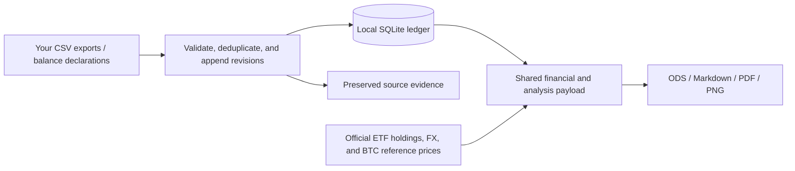

<p align="center">
  
</p>

<h1 align="center">Wealth Ledger</h1>

<p align="center">
  <strong>Turn brokerage and Bitcoin CSVs into a private investment ledger.</strong><br>
  Keep your source evidence, track your history, and generate reports you can inspect.
</p>

<p align="center">
  <a href="https://www.python.org/downloads/"></a>
  <a href="#tech-stack"></a>
  <a href="LICENSE"></a>
  <a href="#languages"></a>
  <a href="#project-status"></a>
</p>

<p align="center">
  <a href="#quick-start">Quick start</a> ·
  <a href="#reports">Reports</a> ·
  <a href="#tech-stack">Tech stack</a> ·
  <a href="#documentation">Documentation</a> ·
  <a href="CONTRIBUTING.md">Contribute</a>
</p>

---

Wealth Ledger combines **Wealthsimple holdings**, **Bull Bitcoin orders**, and optional **BTC balance declarations** in a local SQLite history. It produces **ODS spreadsheets, Markdown, PDF, and PNG charts** in English, Traditional Chinese, or Simplified Chinese.

**Your CSVs, database, and reports stay in your private workspace.** Normal updates download public reference data; they never commit or push your financial files to GitHub. The financial workflow runs in Python, with no broker login, LLM or local LibreOffice required. The optional browser UI builds with Node; its production server remains Python.

## At a glance

| | What you get |
|---|---|
| 📚 **A traceable ledger** | Original CSV evidence, checksums, dated observations, deduplicated orders, and append-only revisions. |
| 💱 **Three valuation currencies** | CAD/USD native holdings, account breakdowns, and CAD/USD/TWD equivalents with saved reference rates. |
| ₿ **Brokerage + Bitcoin** | TFSA, RRSP, Non-registered, and BTC/LBTC equivalents in one report, with independent source dates and completeness. |
| 🔎 **ETF company exposure** | Direct stocks plus recursive ETF holdings, a ranked top 20, and official sector/country classifications with coverage. |
| 📊 **Reports you can inspect** | Spreadsheet formulas and caches, embedded charts, a portable PDF, Markdown, and machine-readable audit exports. |
| 🧾 **Cash flow and reconciliation** | Explicit contributions, withdrawals, transfers, BTC balances, fees, and unresolved differences with stable IDs. |
| 🌐 **Localized presentation** | `en-CA`, `zh-TW`, and `zh-CN` share the same calculations and preserve source names and references. |
| 🛡️ **Safe import preview** | Optional offline `--dry-run` validates inputs in a disposable project without changing the real ledger. |

Daily commands also support `--workspace /path/to/private/portfolio` to keep data,
reports and backups outside the code checkout. The directory must already exist;
omitting it preserves existing checkout-local use. See [workspace setup](docs/user-manual.md#separate-code-from-private-portfolio-data).

## Reports

<p align="center">
  
</p>

<p align="center"><em>Invented holdings, prices, accounts, and ETF constituents. This is an offline demonstration, not live market data.</em></p>

| View | Included analysis |
|---|---|
| **Portfolio overview** | The same assets valued in CAD, USD, and TWD; account totals, native amounts, rate dates, and source status. |
| **Holdings** | Separate CAD/USD security tables, account tables, position detail, concentration, and account/security matrices. |
| **Company and allocation exposure** | Top 20 companies through ETFs, official GICS and country/market data, geographic groups, and unresolved amounts. |
| **Bitcoin** | BTC/LBTC purchases, quantity-weighted CAD/BTC purchase rates, monthly funding, valuation, optional cost estimates, and balance reconciliation. |
| **History and cash flows** | Actual observation dates, source carry-forward, scope changes, verified flows, and eligible brokerage-period analysis. |
| **Quality and evidence** | Missing information, effective dates, source hashes, methods, and CSV/JSON audit attachments. |

<details>
<summary><strong>What each output is for</strong></summary>

| Output | Purpose |
|---|---|
| `portfolio.ods` | Formula-based tables, cached numeric results, embedded PNG charts, and bundled font licensing. |
| `report.md` | Readable analysis and tables with relative links to charts. |
| `report.pdf` | Fixed-layout analysis with embedded fonts and charts. |
| `charts/` | Standalone PNG figures from the same report run. |
| `data.json`, `manifest.json` | Financial payload, dates, policies, reference sources, localization metadata, and validation. |
| Exposure and BTC audit exports | Full company/classification detail, unresolved exposure, and applicable BTC cost/reconciliation evidence. |

Successful updates preserve editions under `reports/YYYY-MM-DD_HHMM/rNN/`; `reports/latest.json` points to the latest successful publication. ODS charts are static images: spreadsheet edits do not redraw them or write back to SQLite. Regenerate for consistent authoritative outputs.

</details>

## Quick start

Requires **Python 3.12+**. Installation currently uses a source checkout and the locked dependencies; there is no supported PyPI/wheel installation.

```bash
git clone https://github.com/gh-slee/wealth-ledger.git
cd wealth-ledger
python3 -m venv .venv-portable
source .venv-portable/bin/activate
python -m pip install -r requirements.lock

# Try invented data first. No network or personal ledger is used.
python examples/demo.py --output work/demo
```

Open `work/demo/report.pdf`, `work/demo/report.md`, or `work/demo/portfolio.ods`. Choose a new output directory for each demo run. See [the example guide](examples/README.md) for other languages and the explicit BTC cost-proxy demonstration.

<details>
<summary><strong>Windows PowerShell</strong></summary>

```powershell
git clone https://github.com/gh-slee/wealth-ledger.git
cd wealth-ledger
py -3.12 -m venv .venv-portable
.venv-portable\Scripts\python.exe -m pip install -r requirements.lock
.venv-portable\Scripts\python.exe examples/demo.py --output work/demo
```

No activation is required with these explicit paths. For the remaining examples, replace `python` with `.venv-portable\Scripts\python.exe`, and use single-line commands instead of Bash continuations. Recreate the virtual environment when changing platforms. Full Windows acceptance remains pending; see [project status](#project-status).

</details>

### Use your own data

A new checkout has **no financial history or personal accounts**. Your first valid input creates your own ledger and baseline.

```bash
# Preview supported inputs without committing financial data.
python scripts/update.py /path/to/holdings.csv --dry-run

# Import Wealthsimple holdings and generate reports.
python scripts/update.py /path/to/holdings.csv

# Use either source, or both after their initial setup.
python scripts/update.py /path/to/holdings.csv /path/to/orders.csv
```

| Input | Current support | First-use requirement |
|---|---|---|
| **Wealthsimple** | Native Holdings report CSV with required columns and an `As of` footer; long CAD/USD holdings. | A complete export for the intended accounts. Screenshots and native activity statements are not holdings inputs. |
| **Bull Bitcoin** | Supported CAD Funding/Buy Bitcoin orders; BTC/LBTC delivery. | Supply your checked Bull opening declaration with `--bull-opening-file`. |
| **Optional BTC total** | Dated BTC quantity across the tracked wallets, including LBTC at 1:1 equivalent. | Supply quantity, not its CAD/USD market value. No CSV is required for a balance-only update. |
| **Cash flow / BTC events** | Documented normalized CSV templates and explicit CLI commands. | Verified evidence, stable account/event references, and coverage declarations where required. |

For the first Bull import, copy [the synthetic opening template](config/bull-opening.example.json) to a private file, verify its assumptions, and replace its example evidence:

```bash
python scripts/update.py /path/to/orders.csv \
  --bull-opening-file /path/to/private-bull-opening.json
```

Pre-Bull holdings are a separate declaration; do not invent purchases or treat the template's zero assumptions as your actual whole-wallet opening. [The manual](docs/user-manual.md) covers opening quantity, contributions, optional balances, late explanations, revisions, and recovery.

### Dates, missing months, and performance

Upload either supported CSV, both, or an optional BTC total. Monthly snapshots are a convention, not a deadline: a six-week or two-month gap uses actual dates and never fabricates missing month-end observations.

- Carried sources retain their original dates. Bull exports deduplicate orders; they do not prove historical wallet balances.
- No-input `update.py` preserves the saved valuation time while requesting latest official ETF analysis. It does not create a fresh observation for today.
- Holdings changes and purchase spending do not establish contributions. Transfers and Bull Funding/Buy must not be counted twice.
- Unrealized P&L is not a period return. Combined brokerage+BTC Modified Dietz/XIRR remain disabled until the required flow, scope, and valuation coverage exists.

## Tech stack

| Layer | Technology | Role |
|---|---|---|
| 🐍 Runtime | **Python 3.12+** | CLI, parsers, calculations, downloads, and report generation. |
| 🔐 Optional API | **FastAPI · Pydantic · pwdlib/Argon2id · Uvicorn · Huey** | Server-side owner sessions, isolated portfolio settings and protected registered artifacts and isolated report jobs. |
| 🖥️ Browser | **React · TypeScript · Vite · Tailwind · shadcn/Radix** | Same-origin dashboard, TanStack Query/Table and ECharts; static production assets. |
| 🗄️ Ledger | **SQLite · `sqlite3`** | Local observations, order revisions, flows, and reconciliation history. |
| 🧮 Financial arithmetic | **`decimal.Decimal` · satoshi precision** | Explicit precision; BTC quantities support eight decimal places. Unknown values stay distinct from zero. |
| 📊 Charts | **Matplotlib · Pillow** | PNG analysis charts and image handling. |
| 📄 PDF | **ReportLab · pypdf** | Embedded-font PDF generation and presentation checks. |
| 📑 Spreadsheets | **Python `zipfile` / XML · ODF 1.2** | Direct ODS packaging, OpenFormula references, cached values, and embedded images. |
| 🌐 Localization | **UTF-8 JSON · `ContextVar` · Noto Sans TC/SC** | Three static language catalogs, isolated rendering contexts, and bundled fonts. |
| 🔗 Reference data | **Python HTTP clients · certifi** | Official issuer holdings, FX references, and saved BTC price evidence. |
| 🧪 Verification | **`unittest` · formula/cache and PDF/XML checks** | Isolated synthetic tests, source consistency, and publication checks. |
| ⚙️ Automation | **GitHub Actions · `requirements.lock`** | Linux/Python 3.12 tests and offline demos; the initial remote run passed. |

No database server, JavaScript runtime, office suite, or AI service is required for production use. GitHub CLI is only for the separate maintainer publication workflow. Core dependency versions are pinned in [requirements.lock](requirements.lock); the optional API uses [requirements-web.lock](requirements-web.lock). third-party licenses are described in [THIRD_PARTY_NOTICES.md](THIRD_PARTY_NOTICES.md).

### How it works



Normal analysis fetches the latest data **published by supported official issuers**, with effective dates, download times, hashes, and parser versions. Unsupported funds and failed or partial classifications remain visible. Sector uses explicit official GICS; country is not revenue geography or listing currency. Saved historical FX/prices are not replaced by today's references. See [the report specification](docs/report-spec.md).

## Languages

| Locale | Report language | Default behavior |
|---|---|---|
| `en-CA` | English (Canada) | New ledgers. |
| `zh-TW` | Traditional Chinese (Taiwan) | Existing ledgers without an explicit language setting. |
| `zh-CN` | Simplified Chinese (China) | Available by explicit selection. |

```bash
python scripts/update.py /path/to/holdings.csv --locale zh-TW
python scripts/btc_events.py --locale zh-CN --help
```

For a lasting preference, copy `config/local.example.toml` to ignored `config/local.toml` and edit its existing `[reporting]` section. A CLI override affects only that invocation. Symbols, company/account names, user notes, source references, JSON keys, and CSV headers remain unchanged. Language does not change currencies, timezone, or financial history; dates still use `America/Toronto`.

To create another language edition of a saved report **without downloads or ledger/latest changes**:

```bash
python scripts/render_report.py \
  --from-report /path/to/saved-report-bundle \
  --locale en-CA \
  --output /path/to/new-english-edition
```

The bundle needs `data.json`, a manifest, and frozen analysis; output must be a new directory outside it. Legacy manifests without a data checksum provide metadata consistency checks rather than full source authentication. See [the locale guide](docs/i18n-plan.md). Canonical project documentation is English. Reports and daily CLI output support the three locales above; translated documentation editions remain planned.

## Data and privacy

```text
data/db/portfolio.sqlite3    Your local ledger
data/raw/                   Your original imports and source evidence
reports/                    Your immutable report editions and charts
backups/                    Your local database backups
config/local.toml           Your ignored language and cost settings
config/publish.local.toml   Optional ignored maintainer publication authorization
```

**Normal imports and reports never upload financial files or publish to GitHub.** Your accounts, opening holdings, and history come from your own inputs. Public examples and the README preview contain invented data only.

Private directories, databases, reports, and local settings are Git-ignored. Optional maintainer hooks and publication tools additionally check reviewed paths, staged contents, and reachable history. Ignore rules do not remove already tracked data, and checks cannot guarantee protection against every human mistake. Never paste financial data into public source/examples or attach it to an issue. See [publishing guidance](docs/publishing.md) and [the security policy](SECURITY.md).

SQLite has no built-in password or encryption in this tool. Protect local files and backups; same-disk copies do not replace a separate backup of the complete private state.

### Calculation boundaries

The default BTC policy is **`actual_only`**. Missing pre-Bull acquisition costs and unknown wallet cost allocation are not filled with zero. The optional `bull_average_proxy` applies the completed-Bull weighted purchase price to current BTC-equivalent quantity as a clearly labeled estimate; it does not reconstruct actual historical costs or settle reconciliation gaps.

The tracker does not trade, log into brokers/wallets, independently verify on-chain ownership, calculate tax ACB/CRA contribution room, or assume omitted files mean no activity. Read [the manual](docs/user-manual.md) before using estimated costs or period analysis.

## Documentation

| Guide | Start here for… |
|---|---|
| [User manual](docs/user-manual.md) | Input setup, contributions, BTC balances/events, dates, revisions, and recovery. |
| [Report specification](docs/report-spec.md) · [ODS implementation](docs/workbook.md) | Report contents, interpretation, formulas, charts, and validation. |
| [Core API](docs/core-api.md) · [BTC reconciliation](docs/btc-reconciliation-plan.md) | Data contracts, stable IDs, intervals, and financial invariants. |
| [Languages](docs/i18n-plan.md) | Locale configuration, offline editions, and translation contributions. |
| [Browser workflow](docs/web-frontend.md) | Sign-in, imports, frozen analysis, downloads and frontend development. |
| [Source-adapter design](docs/source-adapters.md) | The planned extensible parser/plugin contract. |
| [Development](docs/development.md) · [Contributing](CONTRIBUTING.md) · [Agent setup](docs/agent-development.md) | Environment setup, verification, instructions, and pull requests. |
| [Publishing](docs/publishing.md) · [Security](SECURITY.md) | Private/public separation and reporting a vulnerability. |

Need help? Check `python scripts/update.py --help`, then [open an issue](https://github.com/gh-slee/wealth-ledger/issues) with a minimal **synthetic** reproduction. Do not upload real exports or reports. A failed report operation can be inspected/resumed with `--show-operation` / `--resume-operation`; do not repeat an unspecified-time balance as a recovery shortcut.

## Development

See [CONTRIBUTING.md](CONTRIBUTING.md) for installation and tests,
[development procedures](docs/development.md) for CI/report verification, and
[agent setup](docs/agent-development.md) for optional Codex guidance. Features run
without an LLM. The shared project rules are in [AGENTS.md](AGENTS.md).

## Self-hosted web app progress

The Docker self-hosted Web track targets one owner or household with multiple independent portfolios: React + TypeScript + Vite, a FastAPI API, Python background workers, SQLite, and persistent private storage. The API/worker reuse the CLI's financial services and preserve ODS, Markdown, and PDF exports; browser charts and the report library read frozen published observations.

**The browser import/analysis/report workflow is implemented for local acceptance.** See [the browser guide](docs/web-frontend.md) for sign-in, previews, charts, downloads and build/test instructions. Optional owner/session setup, independent portfolios and Docker operation are described in [Web operations](docs/web-operations.md). The [upload/job guide](docs/web-imports.md) covers CSV evidence, offline previews, explicit confirmation, isolated Huey/SQLite workers, three-format report downloads and interruption recovery. The CLI remains available for normal use and advanced financial records. Broader deployment acceptance remains planned. See the [architecture](docs/self-hosted-webapp.md) and [WEB-001–WEB-007 tracker](TODO.md).

## Project status

**Pre-release.** The public source checkout has passed local synthetic tests, a fresh macOS/Python 3.12 dependency-install check, and [Linux/Python 3.12 CI](https://github.com/gh-slee/wealth-ledger/actions/runs/38828304491) with 263 tests plus offline default/proxy and three-language report demonstrations. Broader platform acceptance and an installable distribution remain pending.

Current CSV import supports the documented Wealthsimple and Bull formats. Official ETF adapters have their own registry; version-1 [normalization contracts](docs/source-adapters.md) are implemented, while the general installable bank/broker/exchange **parser-plugin SDK, loader and importer migration remain planned**.

Near-term work is tracked in [TODO.md](TODO.md):

- [ ] Unified read-only ledger/source/reconciliation status.
- [ ] Historical exports and a local report index.
- [ ] ETF overlap and market-value change decomposition.
- [ ] Bull funding origins/transfers and supported combined performance.
- [ ] Versioned source adapters so contributors can implement trusted parsers.
- [ ] More locales and complete translated documentation.

Contributions to supported parsers, synthetic fixtures, translations, documentation, and portability checks are welcome. Please discuss a new financial model or source-adapter contract before implementation.

## License

Code and project documentation are [MIT licensed](LICENSE). Bundled Noto fonts retain their SIL Open Font License terms; downloaded official data and dependencies retain their own rights and licenses. See [THIRD_PARTY_NOTICES.md](THIRD_PARTY_NOTICES.md). The README mark is project artwork; the report preview is generated from the repository's synthetic examples.
