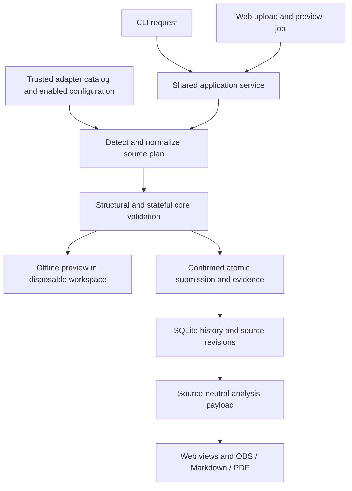

# Source adapters and user-defined parsers

Wealth Ledger is intended as a shared investment ledger for bank, brokerage,
Bitcoin broker and exchange exports, rather than an application tied to a single
institution. Source-specific parsers will normalize supported formats while shared
services own validation, evidence, history and reports. Wealthsimple holdings and
Bull Bitcoin orders are the first built-in importers, not a limit on that scope.

**SRC-001 is implemented as the version-1 normalization contract in
`wealth_ledger.source_protocol`; SRC-002A provides an independent trusted registry
in `wealth_ledger.source_registry`. SRC-002B adds nonbooking CLI/API source plans
and code/configuration fingerprints. SRC-003 adds an installable core/contract,
[author SDK and independent synthetic parser](parser-sdk.md).** Migration of current
importers and production financial integration remain planned (SRC-004B/C).
[SRC-004A](source-ingestion.md) implements the explicit-context v2 contract and
canonical storage foundation, with a report-projection phase gate.
The current CLI and Web workflow use direct built-in Wealthsimple/Bull importers,
not a source-plugin registry. They also support normalized cash-flow inputs and
explicit BTC declarations; they cannot import arbitrary institution CSVs. Moving
the existing importers behind the common contract is SRC-004, after registry and
author-toolkit work. The official ETF registry is separate. See [TODO](../TODO.md).

## Goal

Let developers/users implement trusted parsers for additional bank, broker and
crypto-exchange CSVs without changing SQLite history or report code for each source.
Detection/normalization are extensible; core validation, atomic submission,
deduplication/revisions, tracking scope and reporting remain central.

All production work must be reproducible Python, independent of LLMs, agents,
browser login or local office software. The protocol below is available for contract development; it is not an enabled
import interface. Future loading/submission commands do not exist yet.

## Version-1 canonical record kinds

| kind | Purpose | Required boundaries |
|---|---|---|
| `holdings` | Accounts, positions, cash and source cost at a source time | Full/partial account scope, valuation time, instrument identity, currency, revisions |
| `cash_flows` | External deposits/withdrawals, tracked-account transfers, income/fees | Portfolio boundary, paired legs, dates, FX evidence, coverage declarations |
| `crypto_transactions` | Purchases, sales, delivery, fees and internal/external transfers | Network/asset, precision, cash counterpart, cost coverage, status and cross-source duplicates |

Record count cannot establish completeness; source scope or an explicit declaration
is required. Unknown fees/costs/missing cash counterparts stay unknown. Unsupported
kinds/types must be rejected or identified as incomplete rather than silently skipped.

## Versioned protocol and registration

Each adapter declares stable provider/adapter IDs, adapter version, supported export
versions, protocol API version and kinds. Provider/account namespaces must not depend
on filenames or repeated display names; platform IDs must not collide.

Core registration and external package entry points use versioned contracts. Reject
unsupported API versions, duplicate adapter IDs and invalid capability declarations
before execution rather than guessing compatibility. Enabled adapters/versions may
be saved in ignored local configuration and operation evidence. A public clone
must not automatically load a maintainer-specific parser.

Built-in/external adapters share contract tests. External dependencies are explicitly
installed/enabled by the user; encountering a CSV never downloads Python code.

## Separate detection, normalization and submission

1. **Detect:** inspect necessary fields/format features and return an auditable
   match/version without real writes, private credentials or code downloads.
2. **Resolve ambiguity:** reject no matches. Multiple trusted matches require an
   explicit source choice, not LLM/filename guessing.
3. **Normalize:** produce defined canonical records and source/coverage metadata,
   mappings and warnings, without writing SQLite or generating reports.
4. **Validate centrally:** check Decimal, dates/timezones, asset/account identity,
   source IDs, status, transfers, scope and cost coverage, then submit atomically.
5. **Retain evidence:** raw SHA-256, format/adapter/protocol versions, source effective
   time, normalized results and operation ID support replay and revisions.

Offline `--dry-run` must reuse detection/normalization/validation without modifying
the real project, performing new network queries or retaining temporary IDs. An
external parser unable to meet these limits cannot claim this preview contract.

## Required canonical semantics

- Account identity combines provider namespace/source account ID, not display names
  or masked suffixes alone.
- Positions retain market/asset/currency identity and original cost. Matching ticker
  text alone cannot merge instruments from different sources.
- Economic events use stable source IDs with completed/pending/cancelled state and
  effective times. Missing IDs need an explicit auditable policy, not amount/date-only deduplication.
- Distinguish reimports, content conflicts and legitimate equal-time/amount events.
  Economic revisions/cancellations and input corrections must not silently overwrite.
- Trace original values, currency direction, network, fees and evidence. A transfer
  reference alone does not verify every counterpart.
- Keep observed balances distinct from transaction history. Do not add pre-observation
  transactions again or automatically label discrepancies as fees.
- Account additions/removals require explicit scope revisions; format changes are
  not evidence of investment growth.

The concrete version-1 dataclasses and validators are described below. Database
migration, stateful deduplication/revisions, portfolio boundary matching and
submission are still SRC-004 work. A structurally valid batch alone cannot establish
financial completeness or authorize a contribution.

## Implemented protocol surface (SRC-001)

`source_protocol.py` provides frozen dataclasses and a `SourceAdapter` Protocol:

- `AdapterInfo`: API version **1**, provider/adapter namespace, adapter version,
  supported export versions and record kinds. `validate_info` rejects unsupported
  versions, invalid/duplicate capabilities and unstable namespace syntax.
- `AccountKey(provider, account_id)` and `RecordKey(account, source_id, revision,
  supersedes_revision=None, change="original")`: identity never depends on a path
  or display label. Corrections/voids require a distinct superseded revision.
- `AssetKey(kind, symbol, currency, market=None, network=None, identifier=None)`:
  securities require a market; crypto requires a network; cash matches its currency.
  `currency` is the valuation currency. BTC/LBTC quantities require whole satoshis.
- `Holding`: source time, signed Decimal quantity, market value and optional cost.
  `CashFlow`: positive amount, direction/type, status, explicit boundary and optional
  counterpart references. Counterpart source IDs require their provider/account
  namespace; a transfer reference does not verify the other leg.
- `CryptoTransaction`: source-reported signed `CryptoLeg` quantities, status,
  optional acquisition cost, fees and transfer/counterpart references. `fees=None`
  means unknown; `fees=()` means explicitly no separate fees. Do not apply the same
  fee to a leg and acquisition cost twice. BTC and LBTC retain different networks;
  this contract does not automatically net swaps or infer contributions.
- `Coverage`: kind/account, inclusive timezone-aware start/end, completeness,
  declared basis, scope ID and scope revision. Every record must have a covering
  declaration. An empty record list cannot change declared completeness.
- `SourceEvidence`: raw SHA-256, effective/fetch times, source reference, field
  mappings, warnings and stable-ID policy. `NormalizedBatch` retains this evidence,
  adapter/version, selected export version, coverage and records.

`detect(raw: bytes) -> Detection` and
`normalize(raw: bytes, *, export_version: str) -> NormalizedBatch` are pure trusted
Python operations. They receive no workspace, credentials or database. No network,
file writes or subprocesses are permitted. This is a contract, not a Python sandbox.
`resolve_detection` accepts already evaluated trusted results, rejects duplicate
adapter IDs and zero/multiple matches, and never discovers or installs code.

`validate_batch(batch, raw)` checks hashes, versions, kinds, Decimal/nonfinite
values, timestamps, currencies, identity, coverage, local revision shape, status
and satoshi precision. Each source record may occur only once per kind/account in
one batch; adapters must resolve export revisions explicitly. Event voids require
cancelled status. Pending/cancelled records remain evidence and must not be booked
as completed activity. Observed BTC totals remain the existing balance-observation
API, not crypto transactions.

`canonical_json` preserves Decimal as strings, aware ISO timestamps, null unknowns
and all version/evidence fields. Validate first. It is a deterministic evidence
serializer, not a database importer or generic JSON deserializer.

Future transactional checks must still verify revision lineage against the ledger,
portfolio membership, duplicate economic effects across sources, cash counterpart
completeness, transfer matching, disposal/cost allocation and scope changes. Batch
validation does not claim these stateful checks are implemented. No runtime LLM is
involved. The offline synthetic acceptance cases are in `tests/test_source_protocol.py`.

## Banks, brokers and exchanges

**Banks:** establish deposits/withdrawals across the investment boundary. Importing
a bank CSV does not add bank cash to investment assets; tracked cash-account scope
must be explicit. Bank outflow and broker inflow can be one movement requiring
auditable matching, not two contributions.

**Brokers:** snapshots and activity/trade history are different kinds. They can
complement each other, but trade turnover is not external contributions. In-kind
transfers, multiple currencies, splits and refunds require supported source/scope policies.

**Exchanges:** separate purchases/sales/deposits/withdrawals/fees and own-wallet
transfers. Exchange delivery and wallet receipt must not double count. A sale with
no cash counterpart cannot invent cash; quantities alone do not establish complete cost.

## Intended custom-parser workflow

The [SDK guide](parser-sdk.md) now supports these steps for nonbooking plans:

1. Read the public protocol/schema and synthetic example plugin.
2. Implement detection/normalization with explicit supported formats/types.
3. Run offline mapping/deduplication/timezone/revision/scope/transfer/fee contract
   tests using synthetic or properly sanitized fixtures.
4. Install a trusted package into their venv and enable registration/entry points
   without editing the core.
5. Preview offline without financial submission; maintain parser versions/tests
   when export formats change.

Native wheel installation, exact host enablement and a derived-image workflow are
documented in the SDK guide. Finish SRC-004 before claiming production custom-parser
financial imports or support for additional institutions.

## Implemented registry library (SRC-002A)

`source_registry.py` is an optional Python library. The production CLI/Web upload,
financial preview and import paths do not invoke it yet. The independent source-plan
CLI/API does use this registry, while the registry itself does not normalize batches,
write the ledger, install packages or generate reports. SRC-004B1 supplies explicit `source_builtin.registrations()` for the two implemented
v2 formats. `source_context_pipeline` uses them for nonbooking previews only; native
financial submission and report projections remain on their compatibility paths.

- `ProviderInfo(provider_id, display_name)` gives consistent provider metadata.
  Multiple adapters/export formats may share a provider; conflicting metadata or
  duplicate adapter IDs fail. Adapter IDs and metadata use the existing API-v1
  contract plus bounded registry names/text; unsupported API versions are rejected.
- `AdapterRegistration(provider, adapter)` supplies a trusted built-in instance,
  or is returned by an external entry point's no-argument factory. The adapter must
  expose valid `info` plus callable `detect` and `normalize` methods. This verifies
  the interface, not the safety or financial correctness of installed Python.
- `discover_plugins()` returns sorted `PluginCandidate` metadata from installed
  distributions under `wealth_ledger.source_adapters`, without loading entry points.
  Invalid metadata and colliding distribution/entry-point identities fail explicitly.
- `PluginSelection(distribution, version, entry_point, adapter_id)` enables one exact
  installed distribution version and entry point. Distribution names are normalized
  for comparison; versions are exact strings, not version ranges. Each selected
  package must return the expected adapter ID. Adapter versions and distribution
  versions are separate fields and may differ.
- `build_registry(builtins=(), enabled=(), catalog=None)` returns an immutable
  `SourceRegistry` snapshot. Empty enablement does not scan installed distributions
  unless a catalog is supplied. Metadata availability/version and selection collisions
  are checked before any selected factory loads. Only explicitly enabled factories
  run; nothing is enabled merely because it is installed or matches an input.
- `registry.adapters` returns immutable descriptors with provider, declared adapter
  info and optional external selection. `registry.detect(raw, adapter_id=None)`
  accepts nonempty `bytes` up to 10 MiB. It returns `SourceMatch` with the descriptor,
  selected export version and source reason. It never calls `normalize` or books
  financial effects. Mutable/empty/oversized inputs and malformed detector results
  fail; changing an adapter's declared info after registration is rejected.
- Detection evaluates adapters in stable ID order. No match fails; multiple matches
  require an explicit enabled adapter ID. A detector exception fails the scan even
  if another adapter matches. An explicit ID narrows detection to that adapter and
  must still match; it cannot force unsupported bytes through a parser.
- `RegistryError.code` is stable (`unavailable_plugin`, `ambiguous_plugin`,
  `duplicate_adapter`, `conflicting_provider`, `incompatible_adapter`,
  `detection_failed`, `invalid_detection`, `no_match`, `ambiguous_detection`, and
  other structural configuration/adapter/input codes). Messages and suppressed
  plugin exception chains do not contain raw rows, paths or plugin exceptions.
  Returned detector reasons remain private source evidence, not public log text.

The registry accepts immutable Python configuration. The SRC-002B layer below
loads strict host JSON, fingerprints code/configuration and runs bounded nonbooking
previews; there is no browser enable endpoint. Financial submission remains a
separate contract; discovery/loading/planning alone does
not make an additional CSV format importable through the normal application.

Offline tests use built-in fakes and an independently written temporary module with
real distribution/entry-point metadata. Existing commands to run focused checks:

```bash
PYTHONPATH=src python -m unittest discover -s tests -p 'test_source_registry.py' -v
PYTHONPATH=src python -m unittest discover -s tests -p 'test_source_protocol.py' -v
```

## Nonbooking source plans (SRC-002B)

`source_pipeline.plan_sources` is shared by `scripts/source_parsers.py` and the
owner-only Web API. It runs trusted detection/normalization in a fresh Python child,
validates the protocol-v1 batch and returns a JSON summary/receipt. **Every result
is `status: plan_only`, `ingestible: false`, with `protocol_v1_not_bookable`.** There
is no financial confirmation path, SQLite submission, contribution inference,
reference download or report publication. Existing financial imports and `--dry-run`
retain their current behavior. The browser interface has no source-plan form yet.

### Host configuration

The CLI requires an explicit `--config` file. Web uses the private instance file
`admin/source-parsers.json`; absence means no external adapters enabled. Only a
trusted host operator edits it. Browser requests cannot supply configuration,
Python paths, factories, package names/URLs or enablement. Do not store credentials
in this file. Example **hypothetical** parser configuration (not an available bank):

```json
{
  "schema_version": 1,
  "enabled": [
    {
      "distribution": "example-bank-parser",
      "version": "1.0.0",
      "entry_point": "holdings",
      "adapter_id": "example.holdings"
    }
  ],
  "bindings": []
}
```

The schema requires exactly these top-level keys. Unknown/duplicate keys, nonfinite
JSON, invalid identities and duplicate account bindings fail. At most 32 enablements,
200 bindings and 64 KiB are allowed. An optional binding has `provider_id`,
`source_account_id`, and `ledger_account_id`; its exact configuration is fingerprinted.
Version 1 does **not** rewrite account IDs or apply these mappings to ledger rows;
stateful identity binding and source parse context are SRC-004 work. Real financial
bindings must be portfolio-scoped and checked against that ledger; never apply this
host-level planning declaration across portfolios as a global account assignment. An enabled
entry-point factory must return `AdapterRegistration`. The original context-free
planner requires API-v1; the separate explicit-context planner requires API-v2.

Normal dependency installation/packaging is an operator prerequisite, not a feature
of this command. The [installable core/author SDK](parser-sdk.md) is SRC-003;
financial submission and importer migration remain SRC-004.
The application does not fetch or install plugins when given a CSV. Use only trusted
compatible code in the same controlled Python environment as the application.
Change installed packages while services are stopped, then restart API/worker
together; do not update executable dependencies in a running financial environment.

### CLI preview and revalidation

After installing/enabling a compatible trusted parser and saving private host
configuration, these are implemented commands. The example paths are placeholders:

```bash
python scripts/source_parsers.py /path/to/export.csv \
  --config /path/to/private/source-parsers.json > /path/to/private/source-plan.json

python scripts/source_parsers.py /path/to/export.csv \
  --config /path/to/private/source-parsers.json \
  --verify /path/to/private/source-plan.json
```

Use private directories/files (for example, a shell `umask 077`). Up to five CSV
paths can be supplied. Optional `--select 1=example.holdings` selects an enabled
adapter for the first file; repeat for other 1-based slots. Unsupported or ambiguous
formats fail, and an explicit choice must still match. `--timeout` is a positive
wall-clock limit no greater than 60 seconds. Failure returns exit code 2 and a
redacted JSON error; success returns the plan and exit code 0. There is no import
or commit option. A plan contains hashes/counts/metadata rather than account IDs,
raw rows or normalized financial records, but still belongs in private storage.

### Web API preview and revalidation

Use the existing authenticated, CSRF-protected API under
`/api/v1/portfolios/{portfolio_id}`:

1. Upload bounded CSV bytes with `POST /uploads?kind=source_csv&filename=export.csv`.
   HTTP checks generic CSV structure only; it never executes a detector/factory.
2. Send `POST /source-plans` with `Idempotency-Key` and
   `{"upload_ids":["SERVER_UPLOAD_ID"],"selections":{}}`.
3. The existing worker runs a `source_plan` job. Poll the existing `/jobs/{job_id}`.
   A successful result is `ready` **for inspection only**, with no core operation ID.
4. Revalidate using another `/source-plans` request with the same input IDs/options
   plus `"previous_plan_id":"COMPLETED_PLAN_JOB_ID"`. It compares the new receipt
   against the prior one. Prior jobs must belong to the same portfolio, be ready,
   remain within 24 hours and have unchanged portfolio inputs.

`selections` maps 1-based input slots to enabled adapter IDs, just as the CLI does.
`source_csv` uploads are rejected by normal financial `/previews`; source-plan jobs
are rejected by financial `/jobs` confirmation and `/resume`. Existing upload byte,
quota, authorization and evidence hash checks still apply. Interrupted source plans
are marked interrupted rather than retried as financial work. Backups retain host
configuration, uploads and receipts; restore expires queued/running/ready source
plans and never loads/installs a plugin. Frozen reports remain readable without it.

### Fingerprints, limits and guarantees

The receipt binds raw bytes and slot selections, exact host configuration/account
mapping hashes, selected adapter/API/export metadata, enabled registry catalog,
canonical normalized-output digest and runtime/core/dependency environment digest.
Its own fingerprint covers the entire receipt body. Modified receipt JSON fails
validation. Receipts are integrity comparisons, not signed attestations or authority
to book protocol-v1 records.

`source_environment` hashes actual files in the application package, Python standard
library, installed site-package roots (including unlisted files and distribution
metadata), and the Python executable/runtime identity. This catches same-version
plugin/dependency edits, not just package version changes. There is no persistent
hash cache. Scans fail if incomplete or beyond 50,000 files/1 GiB. Unsupported
external/editable paths, executable `.pth` hooks, directory symlinks and escaping
file links fail rather than being omitted. Recognized standard-library libpython
links within the Python base installation are hashed through their targets.
API/worker environments must match; incompatible environments block processing.
This is a controlled-environment requirement, not cross-platform equivalence.

Each child starts with a private empty bytecode prefix and bytecode writes disabled,
so excluded caches cannot supply stale code. Its environment is limited to required
OS variables plus fixed Python settings. Inputs/configuration and receipt IO use
private temporary storage removed afterward. Child stdout/stderr are discarded;
plugin exceptions become stable redacted codes. The parent enforces the wall limit,
checks bounded receipt output and rechecks original inputs/config after processing.
The child compares environment hashes before loading and after normalization.

Limits are five files, 10 MiB/file, 25 MiB/batch, 50,000 CSV rows and 256 columns;
normalized evidence is limited to 4 MiB/file and a receipt to 1 MiB. These limits do
not sandbox trusted Python or guarantee a memory ceiling for a malicious plugin.
Parsing must remain offline and side-effect-free under the contract. Generic
financial validation, lossless protocol-v2 context, transaction-time lineage checks,
canonical persistence is a gated SRC-004A developer API; production submission and
provider-neutral report projections remain SRC-004B/C.

Synthetic acceptance covers actual entry-point metadata in a temporary isolated venv,
identical CLI/Web receipts using that real child/adapter, same-version code/dependency
changes, config/input changes, timeouts, redacted failures, API scope/idempotency,
nonbooking rejection, crash interruption and empty-instance backup restore.

## Implementation blueprint (planned: SRC-002 through SRC-004)

This section plans financial integration. SRC-002A and SRC-002B are implemented
as the independent registry and nonbooking plan paths above; SRC-003 adds the
installable SDK and SRC-004A the gated canonical foundation. Production financial
ingestion, existing-parser migration and source-neutral reporting remain unavailable. Keep the existing CLI/Web behavior until each
replacement passes its acceptance gate. The production parser pipeline remains
Python code; external Python parsers are explicitly trusted extensions.

### Current coupling to replace

| Existing location | Current responsibility and coupling | Planned boundary |
|---|---|---|
| `workflow.identify_inputs` | Matches two provider-specific header sets and returns a provider-keyed dictionary | Generic detection returns a list of identified source inputs with adapter/version and account scope |
| `core._parse_holdings` | Wealthsimple columns/footer, account IDs, position fields and quality findings | Built-in parser owns source syntax; generic ingestion owns storage and financial checks |
| `crypto._parse` / `import_bull_orders` | Bull syntax, order revisions, archive, opening requirements and submission | Parser owns source mapping; shared ingestion owns evidence, lineage and atomic booking |
| `preflight.preview_update` | Simulates two named importers | Reuses the same source plan and submission validation in a disposable workspace |
| `application.ApplicationService` / `operations` | Shared locks, backup, atomic staged submission, recovery and publication | Retain these services as the single mutation boundary |
| `web.uploads.inspect_bytes` / `verified_upload` | Rejects CSVs unless one of two provider headers matches | HTTP validates bounded text/CSV structure; worker performs trusted adapter detection |
| `web.jobs` | Groups inputs by provider and fingerprints only application code | Pins selected adapters/configuration/code plus input hashes; groups by declared source scope |
| `workflow.choose_valuation_as_of` / `select_context` | Provider-specific selection and carried-source metadata | Source-neutral observation policy using explicit dates, record kinds and scope |

Moving only the header checks or wrapping the old mutation functions in a
`SourceAdapter` would leave the application coupled. Detection, canonical submission,
source selection and report projections must all cross the shared boundary.

### Target pipeline and responsibilities



A plugin receives bounded source bytes and explicit immutable parse context. It
returns source records, metadata, warnings and coverage. It does not choose ledger
paths, write SQL, assign core operation IDs, download quotes, value the portfolio,
calculate contribution coverage, render reports or declare a transfer matched.
The shared service remains responsible for these financial and operational decisions.
ETF/FX/BTC reference retrieval remains separate from financial CSV parser loading.

Module boundaries (v1/registry/nonbooking pipeline, SDK and v2 canonical foundation exist today):

| Module | Responsibility |
|---|---|
| Existing `source_protocol.py` | Versioned immutable contracts, structural validation and deterministic evidence serialization |
| Implemented `source_registry.py` (SRC-002A) | Catalog, explicit enablement, compatibility checks and deterministic candidate selection; not wired into imports |
| Implemented `source_pipeline.py` / `source_environment.py` (SRC-002B) | Bounded nonbooking CLI/API parsing, selection, normalized digests and code/config revalidation; context-aware v2 production planning remains SRC-004B |
| Implemented `source_v2.py` / `source_ingestion.py` (SRC-004A) | Explicit context/lossless fields, canonical state/identity/lineage/effects and atomic persistence; production routing and report projections remain gated |
| Proposed `adapters/wealthsimple.py`, `adapters/bullbitcoin.py` | Built-in syntax/normalization implementations with no database/report access |
| Implemented `source_testing.py` and independent synthetic example | Offline author contract checks; not a generic install/execute service |

### Contract completeness gate before booking

Version 1 is useful for structural parser development, but it cannot losslessly
replace current importers. SRC-004A implements the [version-2 contract and canonical
foundation](source-ingestion.md); SRC-004B/C must still implement production migration
and projections before financial import support is advertised. Keep version-1 validation/serialization stable; never add required
semantics under the same API version or silently coerce a version-1 batch.
Registry discovery can recognize a contract for inspection without accepting its
records for ingestion; compatibility must distinguish these capabilities.

The implemented version-2 contract covers the following source fields; production
parser parity and transactional report projections still need migration acceptance:

- **Explicit parse context:** a trusted execution/evidence timestamp, configured
  source-account alias when absent from the export, declared timezone when source
  times omit it, and explicit source-format selection. Inject these inputs rather
  than calling the clock, reading configuration or inventing account IDs inside a
  parser. Do not require a parser to fabricate `fetched_at` from CSV bytes.
- **Accounts and instruments:** preserve account type/label and masked display
  identity, instrument name/type/market and source-reported prices. Support a
  separate namespaced account-to-ledger binding; account aliases are not filenames.
- **Costs and currency provenance:** preserve both source-native book cost and
  source-reported CAD book cost, their currency/basis and source unrealized values.
  Do not replace source CAD cost with current FX conversion or derive a unit price
  by division when quantity is zero. Missing and explicit zero remain distinct.
- **Snapshot metadata:** source observation time, full/partial account membership,
  position coverage, explicit cash rows, snapshot identity and revision basis.
  Holdings usually lack a trade/order ID; document stable snapshot/position keys.
  An account or position missing from a partial export must not become a disposal.
- **Cash direction and economic links:** version 1 has a positive transfer amount
  but no explicit incoming/outgoing transfer direction. Model it explicitly,
  including income/fees and linked crypto cash legs. A Bull Funding record and a
  Buy record may use the same money; canonical records need links that let the
  core avoid booking two contributions or subtracting the same fee twice.
- **Source detail and statuses:** retain Bull order creation/completion times,
  source status/type, pay-in/pay-out quantities/assets, source IDs and delivery
  networks, including pending/cancelled evidence. Empty/unknown fees are different.
- **Warnings and extensions:** use stable diagnostic codes with locale parameters.
  Source-only extra fields may be retained as bounded audit evidence; financial
  logic cannot depend on arbitrary provider-specific extension dictionaries.

Additional asset classes, short positions, securities trade execution, crypto
sales/swaps and native bank formats require explicitly implemented core capabilities.
A parser declaring one of the three record kinds does not imply every subtype is
bookable. Preview must identify an unsupported effect and block confirmation;
never drop an unsupported completed record and call the import complete. The initial
migration must preserve the two existing formats' supported/rejected behavior.

### Registration, installation and trust decisions

- Built-ins and enabled external adapters use one registry and validation path.
  Providers can have multiple export adapters. Adapter IDs must be unique;
  conflicting provider metadata, duplicate adapter IDs, entry-point collisions or
  unsupported API versions fail explicitly rather than selecting import order.
- Proposed external discovery uses the Python distribution entry-point group
  `wealth_ledger.source_adapters`. An operator installs a pinned, trusted package
  and explicitly enables the exact distribution/entry-point/adapter tuple. Merely
  installing a package or supplying a CSV does not enable or download code.
- Keep executable-plugin enablement at the trusted **instance/CLI host** boundary.
  Portfolio settings can map source accounts and choose among enabled adapters,
  but browser requests cannot supply Python paths, entry points, package URLs or
  enable code. No browser plugin uploader or arbitrary directory scan is planned.
- Metadata enumeration must not import disabled plugins. Import and execute enabled
  parsers in the controlled processing path, not an async HTTP request handler.
  Preserve process isolation for Web jobs. Limits/timeouts must have actual tests;
  pure typing and a child process do not sandbox trusted Python or prevent host I/O.
- SRC-003 provides an audited core wheel/source distribution and independent
  synthetic plugin install flow; see [the SDK guide](parser-sdk.md). Keep a single
  versioned `wealth_ledger.source_protocol`
  implementation shared with plugins; do not vendor incompatible copies of its
  dataclasses into a separate SDK. Packaging or registry work does not authorize
  publishing a package to an external registry.
- Docker users will initially add external plugins through a reviewed derived image
  with pinned dependencies, shared identically by API/worker. Do not install packages
  into the running financial volume. A prebuilt-image plugin marketplace is outside
  this phase; native users install into the controlled application environment.
- Enabled code, dependency inventory and licenses must be reproducible. Full backup
  retains private plugin configuration, versions and digests, not an auto-executing
  package installer. Restore can retain/read frozen reports without the parser;
  new processing/resume requires compatible verified code or an explicit blocked
  state. Never auto-fetch a missing plugin during restore.

### Input selection and preview consistency

Replace provider-keyed input slots with identified source objects. Each retains raw
SHA-256, adapter/provider/API/export versions, account scope, selection reason and
record capabilities. Use the same detector and normalizer in CLI, preview and update.

Zero matches produce an unsupported-format finding. Multiple matches require an
explicit adapter choice from the enabled catalog; reject invalid choices and never
choose by filename, confidence ranking, registration order or an LLM. Detection
errors are distinguishable from nonmatches; an enabled detector that fails cannot
silently disappear from an otherwise successful scan.

The first migration retains current batch byte/file/row limits and existing one-file
constraints for the two formats. Replace provider assumptions with declared scope
conflict checks, not unlimited multi-file acceptance. Overlapping snapshot scopes or
conflicting equal-source revisions block submission. Support for multiple files of
the same provider requires its own deduplication/order tests and documented limits.

Preview evidence must bind raw bytes, source-account mappings, observation/context
choices, selected adapter/API/export versions, normalized output digest, ingestion
schema/policy and the installed adapter **code/dependency digest**. The existing
`web.jobs.engine_fingerprint` covers repository code, so package version text alone
is insufficient for external parsers. A changed mapping, enabled catalog, plugin,
core schema or dependency environment invalidates the preview before confirmation
and is checked again inside the commit boundary. API/worker environment disagreement
must fail explicitly rather than recompute under different code.

A successful preview does not book records or authorize changed code. Replay of
already committed data/report-failure recovery uses saved canonical evidence and
fixed cutoff; it does not parse the original CSV again with a newer plugin. Unknown
pre-commit crash states retain the existing review requirement.

### Persistence, compatibility and reports

Use the existing financial SQLite database and staged atomic-operation mechanism.
Retain raw bytes, normalized batches/digests, parser provenance and source-to-ledger
bindings with explicit schema versions. There must be one financial effect and one
commit marker per accepted event/revision. Sidecar audit evidence must not become a
second independently booked position or cash ledger.

For existing portfolios, preserve current account/security IDs, source archive paths,
snapshot IDs, order IDs/revisions, BTC balance/event/opening links and operations.
Wealthsimple currently hashes its account number without a provider namespace;
use an explicit namespaced binding to the existing ledger ID instead of re-keying
history. Detect collisions with a different provider and block conflicting mappings.
Never reimport all history or rewrite frozen reports to adopt the parser architecture.
Schema changes need explicit backup/upgrade/rollback and empty-restore acceptance.

Submission validation checks existing lineage, same-content reimports, changed-content
revisions, void semantics, source account membership and cross-source economic links.
Distinct source IDs can describe one bank-to-broker transfer; matching requires
explicit evidence and coverage. Unresolved links stay unresolved and cannot count
twice as external contributions. Generic corrections/voids unsupported by the current
cash-flow ledger need a model change before plugins may book them.

Analysis consumes normalized holdings, cash flows, crypto positions and source
coverage rather than branching on provider names. Select valuation cutoffs from
observation kinds/dates and explicit user intent; transaction dates do not establish
wallet observation dates. Preserve missing/carried sources and irregular snapshots.
Source membership changes remain separate from investment gain. During migration,
legacy payload/read projections may remain for old reports and API compatibility,
but new adapters cannot require new provider-name branches in report code. All new
public metadata/diagnostics must support the three existing locales. Do not promise
arbitrary valuation currencies as part of source-plugin support.

### Delivery sequence and acceptance gates

| Increment | Deliverable | Required evidence before claiming completion |
|---|---|---|
| SRC-002A (implemented) | Registry and explicit discovery/enablement, independent of ingestion | Synthetic catalog tests: IDs, multiple formats/provider, disabled plugins not imported, compatibility, deterministic ambiguity and load failures; current imports unchanged |
| SRC-002B (implemented, nonbooking) | Source plans and configuration/code fingerprinting | Identical CLI/Web selection, stale plugin/config/environment rejection, bounded inputs and redacted errors; no financial submission through protocol v1 |
| SRC-003 | Author toolkit and independently packaged synthetic parser | Installation into an isolated environment, entry-point discovery, contract tests and documented native/derived-image workflow; advertise only capabilities actually bookable |
| SRC-004A (implemented foundation) | Version-2 contract, canonical ingestion, identity bindings and additive sub-schema; no production/report switch | Lossless source-field parity, collision/lineage/coverage checks, atomic rollback/retry, backups/empty restore and no duplicated effects |
| SRC-004B | Built-in Wealthsimple/Bull migration across CLI/Web/preview | Old-versus-new synthetic fixtures preserve IDs, rows, costs, quantities, warnings, source dates, duplicates/revisions and account/balance/event links; no direct provider dispatch in active core/report paths |
| SRC-004C | Source-neutral projections and first additional source | New synthetic provider added solely through parser/registration, with no provider branches in core/reports; supported input scope and all report/export paths verified |

The toolkit may demonstrate detection/normalization before general submission exists;
label that limitation explicitly. Choose an actual additional institution only when
its format specification or safely sanitized sample is available. A synthetic third
provider proves extensibility, not real-world support for an unnamed bank.

Acceptance for the complete migration includes either source alone, both together,
no-new-file saved reports, optional BTC-only observations, irregular dates, partial
snapshots, costs/unknowns, overlapping orders, cancellation/revision conflicts,
failed report recovery, schema/backup/restore, unchanged historical reports and
three-locale CLI/Web outputs. Run existing core/Web/frontend/container acceptance
as appropriate; synthetic tests must not read the maintainer's portfolio or require
live accounts or live market/reference downloads. Source contract tests alone do
not establish that the core can ingest an arbitrary new provider.

There is no parser installation command or API enable endpoint. The registry and
nonbooking plans are implemented increments; remaining financial integration should
be reviewed separately without changing existing financial behavior prematurely.

## Trust and publication

External Python plugins run with the user's permissions, not in a sandbox. Install
trusted code and manage versions/dependencies explicitly. Never execute Python
inside CSVs, load code from transaction URLs or run LLM-generated runtime parsers.

Shared parsers must not include real accounts, names, trades, addresses or reports.
Use synthetic fixtures. Core validation protects financial contracts, not the host
from malicious Python. Follow [publication](publishing.md) and
[development](development.md) procedures.

## Opt-in canonical confirmation (SRC-004B2)

The [frozen submission boundary](source-ingestion.md#frozen-submission-and-recovery-src-004b2)
is now implemented for explicitly acknowledged data-only commits. It preserves pure
parsers and portfolio-scoped mappings, validates native compatibility, freezes raw
and normalized evidence, confirms without plugins and recovers only durable receipts.
Original source-plan APIs remain nonbooking. Native daily-workflow/report cutover
and the complete third-provider acceptance remain SRC-004C; this does not advertise
support for arbitrary institution exports or complete source decoupling in reports.
Migration-specific native policies are isolated rather than mixed into parser IO.

## Internal source-neutral model (SRC-004C1)

The [read-only projection model](source-projections.md) now selects verified
per-account holdings observations, preserves native/source-CAD costs, converts
observed values with explicit FX and classifies recorded cash-flow/crypto effects
without provider-name dispatch. It does not execute a parser or publish reports.
C2 adds identity/signature-proven read-only legacy overlap, a shared pure wallet
reconciliation kernel and frozen history/historical cash-flow preservation. Daily
C3A connects BTC declarations to that compatible basis. Daily import/report routing and full acceptance remain C3B/C3C. The data-only receipt and existing report phase gates remain unchanged.
