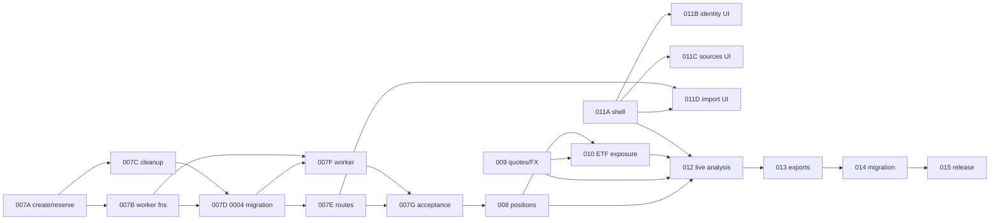
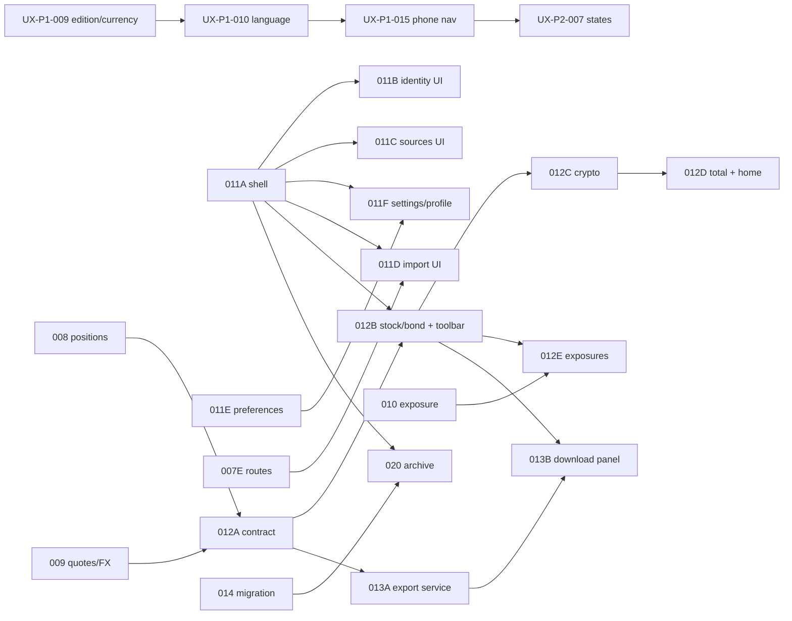

# End-to-end roadmap

Wealth Ledger V2 turns the current single-owner SQLite app into a registered,
tenant-isolated PostgreSQL product with live analysis, ephemeral CSV imports and
on-demand exports. The current CLI and Web app stay usable throughout. This page
orders the work. Each ticket file holds its own scope, acceptance and handoff;
`python3 scripts/tickets.py list` is the live status.

Updated 2026-11-10 (UI/UX backlog pass; see the section at the end). Phases describe sequencing, not approval. Tickets with
`gate: owner` still need the owner's approval before work starts.

## Where things stand

- Done: WL-P0-001 to WL-P0-006 (country labels, governance, domain contract, PG
  foundation, identity backend, source capabilities) and UX-P0-001 to UX-P0-003.
- In progress: WL-P0-007 V2 CSV import acceptance. About half of its SQL surface
  is merged (PR #27, PR #29). `create_set_v1`/`reserve_member_v1` is written but
  uncommitted (WL-P0-007A).
- Everything else is planned.

## Phases

| Phase | Outcome | Tickets |
|---|---|---|
| 0. Enable parallel agents | Tracked tickets, claims, isolated test ports, public specs | WL-P0-017, WL-P0-018, WL-P0-016, WL-P1-006 |
| 1. Import backend | V2 imports work end to end on a synthetic instance | WL-P0-007A → 007B, 007C → 007D → 007E, 007F → 007G; 007H in parallel |
| 2. Valuation inputs | Positions, quotes, FX, ETF exposure | WL-P0-009 (can start now), WL-P0-008 (after 007), WL-P0-010 |
| 3. V2 UI | Eight-route app, identity/source/import/settings screens | WL-P0-011A → 011B, 011C, 011F; 011E and 011G in parallel; 011D (after 007E) |
| 4. Live analysis and exports | Analysis pages on canonical facts, on-demand downloads | WL-P0-012A → 012B → 012C → 012D, 012E (after 010); WL-P0-013A → 013B |
| 5. Migration and release | Legacy cutover, archive access, release gates, docs | WL-P0-014, WL-P0-020, WL-P0-015 |
| 6. P1 growth | First API connector, ETF search, plugin authoring, drilldowns, pull-only install | WL-P1-001 to WL-P1-005, UX-P1-004, UX-P1-005, UX-P1-007 |
| 7. P2 extensions | More institutions, optional financial modes, brand, locales, scheduling, UX-P2 | WL-P2-001 to WL-P2-005, UX-P1-001 to UX-P1-003, UX-P2-001 to UX-P2-005 |

## Parallel lanes

Tickets in different lanes share no exclusive resource, so different agents can
work them at the same time. Inside a lane, work is sequential.

| Lane | Resource | Now | Next |
|---|---|---|---|
| Ingestion SQL | `ingestion-schema-sql` | WL-P0-007A | 007B, 007C, 007D |
| Ingestion review | none | WL-P0-007H | 007G later |
| Market data | `market-contract`, `currency-policy` | WL-P0-009 (after OD-04 + gate) | WL-P0-010 |
| Frontend shell | `frontend-shell`, `frontend-i18n` | WL-P0-011A (after gate) | WL-P0-012 |
| Frontend screens | `frontend-identity-ui`, `frontend-sources-ui` | after 011A | 011B and 011C in parallel |
| Docs/specs | `public-docs-specs` | WL-P0-016 (after gate) | |
| Test harness | `browser-test-harness`, `test-harness` | WL-P0-018, WL-P1-006 | |

A sensible split for four agents today:

- Frontier model A (for example Claude or Codex): WL-P0-007A, then 007B.
- Frontier model B, a different session: WL-P0-007H independent review.
- Standard model: WL-P0-011A once approved, or WL-P1-006.
- Fast model such as DeepSeek Flash: WL-P0-018, then other `any`-tier chores.

## Owner actions that unlock more parallel work

1. Approve WL-P0-017 (this workflow) and WL-P0-016 (publish sanitized specs).
   Without 016, agents on other machines cannot read the detailed specs.
2. Answer WL-P0-007C cleanup-lease questions.
3. Gate A for WL-P0-011 (UI shell and screens) to open the frontend lane.
4. Decide OD-04 market-data providers and gate WL-P0-009.
5. Later: OD-02 (legacy mapping) for 014, OD-11 (platforms) for 015, OD-07 (first API) for WL-P1-001.

## Priority changes in this plan

- The open UX-P1 activity, performance and income tickets moved to P2. V2's
  approved Option A is acquisition-only. Contributions, returns and income need the
  WL-P2-002 mode decision first.
- UX-P1-006 is superseded by WL-P0-011C and WL-P1-003.
- New tickets: WL-P0-007A to H (split of 007), WL-P0-011A to D (split of 011),
  WL-P0-016 (publish specs), WL-P0-017 (this workflow), WL-P0-018 and WL-P1-006
  (parallel-agent test hygiene), WL-P1-005 (re-scope UX P1 for V2), WL-P2-004
  (locales, from I18N-007) and WL-P2-005 (scheduled imports).
- TODO.md items map as follows. FUT-002 goes to WL-P0-012, FUT-003 to UX-P1-005,
  FUT-004 to UX-P1-004 and WL-P1-004, and FUT-005 to WL-P1-004. WEB-008 goes to
  UX-P1-007, platform acceptance to WL-P0-015, the formal legacy restore command
  to WL-P0-014, cash-flow items to WL-P2-002, other adapters to WL-P2-001 and
  off-device backups to UX-P2-004.

## UI/UX backlog pass (2026-11-10)

A screen-by-screen inventory of the shipped application and the planned V2
screens is in [UX_FEATURE_INVENTORY.md](UX_FEATURE_INVENTORY.md). The tickets it
produced, the tickets it improved and the execution batches are in
[TICKET_CHANGES.md](TICKET_CHANGES.md). All new tickets are `backlog` until the
owner releases them.

| Track | Outcome | Tickets |
|---|---|---|
| Shipped application | Fix what users meet today, independent of V2 | UX-P1-008 to UX-P1-015; UX-P2-006 to UX-P2-008 |
| V2 identity and settings | Preferences, Settings and Profile, bundle serving | WL-P0-011E, 011F, 011G |
| V2 analysis | One read contract and one ticket per page | WL-P0-012A to 012E (WL-P0-012 is now their epic) |
| V2 exports | Render service and download panel | WL-P0-013A, 013B (WL-P0-013 is now their epic) |
| V2 archive | Earlier reports readable after cutover | WL-P0-020 |
| Decisions | Delivery order; time zone contract | WL-P0-019; WL-P1-007 |
| Workflow and tooling | Board check, owner inbox, lint, demo, import-path retirement | WL-P1-008, WL-P1-009; WL-P2-006 to WL-P2-008 |

